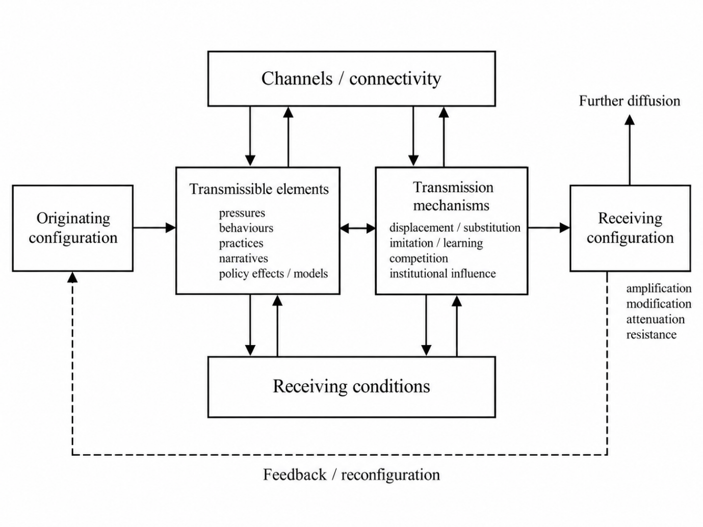
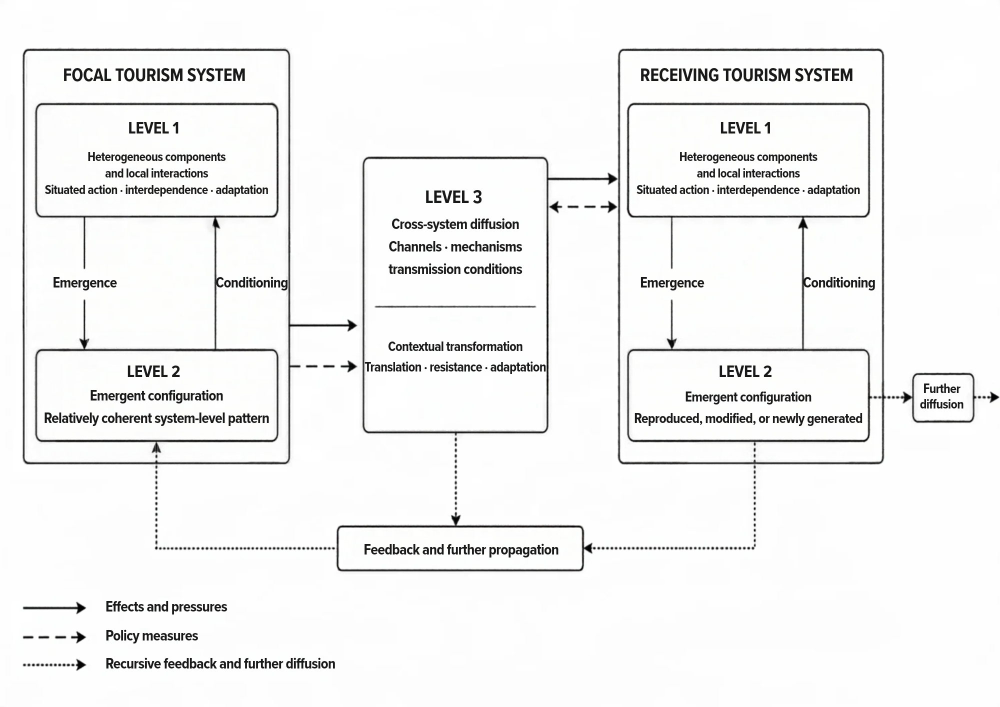
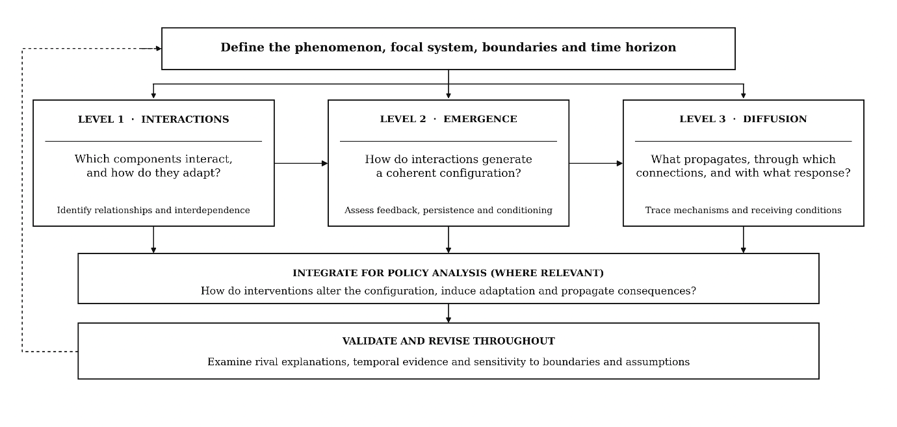
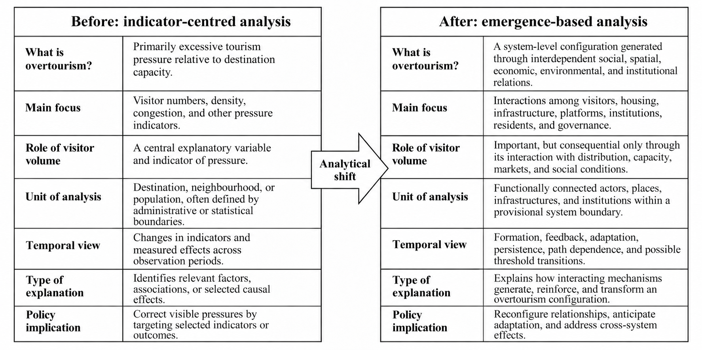
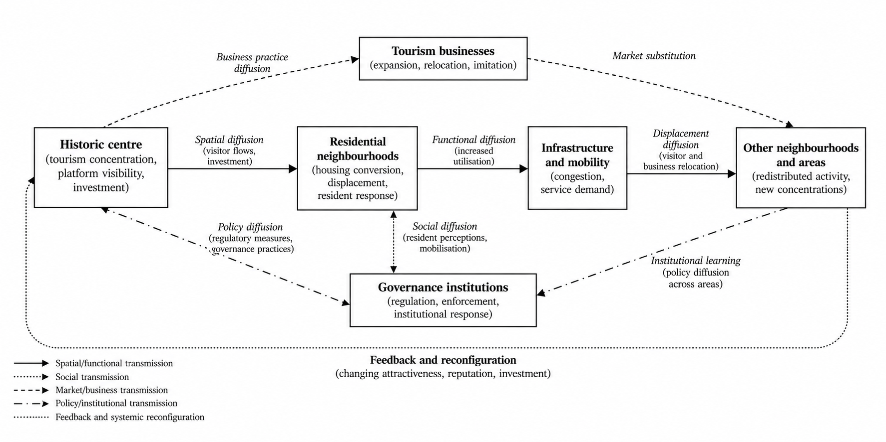

## Abstract {.unnumbered}
Tourism research increasingly recognizes the complex, adaptive, and
interconnected nature of tourism systems, yet many analytical approaches
remain centered on identifying relationships among variables and
estimating bounded effects. Although valuable, these approaches do not
by themsleves explain how interactions generate system-level
configurations, how these configurations evolve, or how their
consequences propagate through interconnected components and settings.
This paper develops an emergence--diffusion framework to advance the
analytical foundations of tourism systems research. Drawing on
complexity science, relational and processual conceptions of emergence,
and diffusion theory, the framework conceptualizes emergence and
diffusion as recursively interconnected processes through which
tourism-system configurations are generated, sustained, and transformed.
It provides an analytical basis for investigating the interactions and
feedback mechanisms underlying emergent configurations, their influence
on subsequent behavior, and the pathways through which pressures,
practices, and responses propagate and change. An illustrative
application to overtourism demonstrates how the framework can inform the
investigation of systemic pressures, their diffusion within a
destination, and the adaptive and distributional consequences of policy
interventions. The paper further discusses its analytical contributions
and implications for anticipatory and adaptive policymaking. By
integrating the generative and diffusive dynamics of tourism systems,
the proposed framework complements established analytical approaches and
broadens the capacity to explain systemic evolution and transformation.

**Keywords:** Tourism Systems; Emergence; Diffusion; Complexity Science;
Causal Inference; Overtourism; Tourism Policymaking.

# Introduction

Tourism research has become increasingly methodologically sophisticated.
Contemporary empirical studies make extensive use of regression-based
models, structural equation modelling, and related multivariate and
econometric techniques. These methods have strengthened the field's
capacities for description, prediction, and evaluation (Ali et al.,
2021; Nunkoo et al., 2013; Song et al., 2019) . Yet methodological
sophistication does not necessarily entail analytical adequacy, nor does
it by itself generate deeper or more comprehensive causal knowledge of
the phenomena under investigation.

This limitation is particularly relevant because many key tourism
phenomena arise within open, complex, adaptive systems. Outcomes such as
congestion, resident opposition, environmental stress, or institutional
change develop through historically conditioned interactions among
heterogeneous actors and structures across spatial and temporal scales.
Because these interactions are interdependent and shaped by reinforcing
and balancing feedback, their collective effects may differ
qualitatively from the additive effects of isolated factors. A
fundamental tension therefore persists between the systemic character of
tourism phenomena and the analytical foundations of much tourism
research.

Approaches designed to isolate variables and estimate specified
relationships may identify associations or effects under stated
conditions, but they are less able to explain how system-level
configurations emerge, evolve, and propagate consequences across
connected contexts. Nevertheless, much tourism research remains
organized around variables and directional relationships. This
orientation is not problematic in itself. Causal claims become
defensible when a study clearly identifies the proposed cause and
outcome, establishes that the cause precedes the outcome, specifies the
intervention or condition being examined, and adequately addresses
plausible alternative explanations. The problem arises when association,
model fit, predictive performance, or directional paths are presented as
evidence of causation without a research design capable of supporting
that inference.

Modern causal inference makes clear that causal conclusions do not
follow from statistical technique alone. They require a clearly
specified causal question, a defensible ordering of cause and outcome,
and a research design capable of distinguishing the effect from
plausible alternative explanations (Hernán & Robins, 2026; Pearl, 2009).
Significant coefficients or well-fitting models may be compatible with a
causal explanation, but they do not establish one.

Even credible causal estimates address only part of the problem. They
concern a defined intervention under specified conditions, and the
estimated effect may change when policy alters those conditions and
actors adapt. For instance, estimating the effect of a tourist tax,
rental regulation, or a mobility restriction does not explain how
destination stress emerges, how actors reorganize, or how consequences
spread across connected settings. Causal inference can estimate the
effects of specified interventions under appropriate identification
assumptions, but such estimates do not explain the endogenous formation
and transformation of the tourism system in which those interventions
occur.

Complexity-oriented tourism scholarship has recognized destinations as
complex adaptive systems characterized by nonlinearity,
self-organization, co-evolution, feedback, path dependence, and porous
boundaries (Baggio, 2008; Farrell & Twining-Ward, 2004; McKercher,
1999). In some applications, however, complexity concepts remain
primarily interpretive, while analytical methods are employed without
sufficiently specifying their explanatory functions. Despite important
advances in complexity-oriented tourism research, further integration is
needed to connect the generation of system-level configurations, the
propagation of their consequences, and the analysis of policy
interventions.

To address this gap, the paper proposes an emergence--diffusion
framework for tourism systems research. Emergence explains how
interactions among heterogeneous components generate system-level
configurations that cannot be adequately reduced to the effects of those
components considered separately (Chalmers, 2006; Green, 2023; Rosas et
al., 2020). Diffusion explains how behaviors, practices, information,
and policy responses propagate through spatial, organizational, market,
and institutional connections, with their transmission and consequences
shaped by the receiving contexts (Ansari et al., 2010; Rogers et al.,
2014; Shipan & Volden, 2008). The two processes are recursive: emergent
configurations create conditions for propagation, while diffusing
elements are transformed by receiving contexts and may contribute to the
formation of new configurations.

Against this background, the paper asks: *How can tourism systems
research explain the emergence and diffusion of system-level phenomena
within and across interconnected tourism systems, and how can these
explanations inform tourism policy analysis and evaluation?* The answer
developed in this paper rests on four interrelated contributions. It
first distinguishes legitimate causal inference from causal vocabulary
unsupported by identification. It then develops a relational and
processual account of emergence and connects it to diffusion through a
three-level framework of local interaction, system configuration, and
cross-system propagation. Finally, it aligns this framework with a
provisional methodological architecture that combines causal,
computational, relational, longitudinal, and process evidence.

Overtourism provides an illustration. Rather than treating it as a
direct effect of visitor numbers, the paper conceptualizes destination
stress as a configuration produced by the interaction of visitor flows
with spatial, environmental, social, infrastructural, and governance
conditions. Once formed, this configuration may propagate through
displacement, imitation, investment, policy transfer, and changing
visibility. The example shows why policy research must examine not only
whether an intervention produces a local effect, but also how that
effect persists, adapts, moves, and transforms within the wider system.

The remainder of the paper is organized as follows. It begins by
examining the foundations of causal explanation and emergence,
establishing the analytical distinctions motivating the proposed
framework. It then develops the emergence--diffusion framework and
outlines its operationalization for tourism systems research. An
illustrative application to overtourism examines the emergence and
diffusion of systemic pressures and their implications for policymaking.
The subsequent discussion addresses the framework's analytical
contributions, scope conditions, research and policy implications, and
limitations. The paper concludes by synthesizing its principal
contributions and implications for advancing tourism systems research.

# Causal Explanation and the Foundations of Emergence

The limitations discussed in this paper do not question the value of
quantitative methods or causal inference in tourism research. Rather,
they concern the interpretation of statistical relationships as causal
evidence without sufficient theoretical justification or appropriate
research designs. Distinguishing association, prediction, and causal
inference is therefore essential, while recognizing that even credible
estimates of specified causal effects do not, by themselves, explain how
tourism systems emerge, evolve, and transform.

## Statistical Modelling and Causal Inference

Tourism studies routinely examine the "drivers", "determinants",
"antecedents", "impacts", or "effects" of observed phenomena. This
language reflects a legitimate aspiration to explain why outcomes occur
and what might change them. The difficulty is that description,
association, prediction, and causal inference are often treated as
interchangeable. Description characterizes observed data; association
identifies how variables vary together; prediction evaluates whether a
model anticipates outcomes in new observations; and causal inference
asks what difference a specified intervention or exposure would make
relative to a counterfactual alternative. Success in one task does not
establish success in another (Pearl, 2009; Shmueli, 2010).

Statistical modelling supports a causal claim only when it is embedded
in a design capable of answering a clearly specified causal question.
Researchers must define the proposed cause and outcome, establish their
temporal order, clarify the intervention or condition being compared,
and address plausible alternative explanations. The potential-outcomes
tradition formalizes this task by comparing the outcomes that would
occur under alternative exposure conditions. Structural causal modelling
instead represents assumptions about the process that generates the data
and asks what follows when that process is intervened upon. Although the
two traditions differ in formal emphasis, both distinguish an observed
association from the effect of changing a cause (Cox & Wermuth, 2004).

This requirement is obscured when a method is treated as intrinsically
causal. Structural equation modelling (SEM) can represent a
theoretically specified causal structure and assess whether observed
covariance is compatible with it. Model fit alone cannot determine
whether the proposed direction is correct, whether relevant confounders
have been omitted, or whether an observationally equivalent structure
offers another explanation. SEM is therefore neither inherently causal
nor inherently non-causal; its interpretation depends on the assumptions
encoded in the model and the design-based reasons for accepting them
(Bollen & Pearl, 2013). The same caution applies to regression controls
and longitudinal data. Controls can introduce bias when they are
consequences of the exposure, mediators, or colliders, while temporal
sequence does not automatically remove reciprocal causation,
time-varying confounding, anticipation, or attrition.

These problems are especially salient in tourism because many central
relationships are reciprocal. Destination image influences visitation,
while accumulated visitation reshapes destination image; resident
attitudes affect policy, while tourism development and policy alter
those attitudes. Similar interdependence connects infrastructure with
demand and digital platforms with accommodation supply. A
cross-sectional survey may provide valuable evidence about perceptions
and covariance, but simultaneous measurement cannot ordinarily establish
temporal mediation, adaptation, or behavioral change.

Reviews of SEM applications in tourism have documented the technique's
rapid diffusion alongside weaknesses in model comparison, assumption
testing, effect-size reporting, and measurement assessment (Mikulić &
Ryan, 2018; Nunkoo et al., 2013). The criticism is not that surveys,
latent variables, or structural models lack value. It concerns an
escalation of the evidential claim: an associational model is estimated,
significant paths are called effects, and interventions are recommended
as though their counterfactual consequences had been established.

Causal overreach commonly occurs when a researcher-imposed arrow
substitutes for temporal and causal ordering, when model fit is treated
as confirmation of a unique causal structure, or when a predictive or
associational result is translated directly into a policy lever. The
last move is particularly problematic when the predictor cannot be
manipulated or when the observed relationship would change under
intervention. Comparable caution applies to Granger-causality tests,
which establish predictive precedence conditional on a model
specification, and to configurational methods, whose sufficient or
necessary combinations still require temporal knowledge and a defensible
generative account before they support causal interpretation (Shojaie &
Fox, 2022).

Machine learning and large-scale digital data do not remove these
constraints. They can improve forecasting, reveal heterogeneity, and
detect nonlinear relationships, but predictive accuracy alone does not
establish the causal effects of interventions (Kleinberg et al., 2015;
Mullainathan & Spiess, 2017). Moreover, increasing data volume does not
eliminate selection bias or problems of representativeness, while
platform-generated data may reflect changing algorithms and historically
contingent patterns of behaviour (Lazer et al., 2014; Meng, 2018).

The corrective action is therefore explicit analytical discipline:
researchers should state whether the purpose is description, prediction,
causal estimation, or systemic explanation; define the causal contrast
when claiming an effect; justify the identification strategy; examine
rival accounts; and restrict conclusions to what the design can support.
When these conditions are met, statistical modelling can provide
credible estimates of specified causal effects. The remaining question
is what such estimates leave unexplained about the wider tourism system.

## Beyond Bounded Causal Effects

Suppose that a study credibly estimates the effect of short-term-rental
regulation on housing prices or of an access restriction on congestion.
Such evidence is valuable because it answers a defined causal question
for a specified population, period, and institutional setting. Its
limitation arises when the estimated effect is treated as an explanation
of the wider tourism system.

A causal effect is generated within a particular institutional,
relational, spatial, and historical configuration. That configuration
shapes the response to an intervention and may itself change once the
intervention is introduced. Interference is especially important: it
occurs when an intervention affecting one unit changes outcomes in
another (Hudgens & Halloran, 2008). For example, restricting access to
one attraction may redirect visitors elsewhere, while regulating
accommodation in one municipality may move supply and investment across
its boundaries. In tourism, interference is often a mechanism through
which effects propagate rather than merely a statistical complication.

Interventions also change through interpretation and adaptation. A
tourist tax, for instance, may be absorbed by firms, passed on to
visitors, accompanied by product redesign, or contested politically.
Visitors, residents, and public authorities may then adjust their
behavior in response. What initially appears to be a single intervention
becomes a branching process of interpretation and adaptation (Hawe et
al., 2009), whose consequences can extend beyond the jurisdiction in
which it originated.

Systemic consequences are also not adequately represented by average
effects alone. A moderate average change may conceal a threshold crossed
by a particular neighborhood, business segment, or social group. A
substantial short-term effect may weaken or reverse as actors adapt,
while initially minor consequences may accumulate through feedback.
Sequence, persistence, and transformation may therefore matter as much
as average magnitude. Systemic explanation must therefore ask how the
initial configuration arose, how the intervention reorganized
relationships, how and where its consequences propagate, and whether it
alters the longer-term trajectory of the system.

The argument is not that causal inference is intrinsically unable to
examine heterogeneous effects and dynamic interventions. These problems
can be addressed when they are explicitly incorporated into the causal
question, research design, and identifying assumptions. The distinction
concerns explanatory scope. Causal analysis estimates the consequences
of a specified contrast within a defined population and setting;
systemic explanation examines how interdependent relationships generate,
change, and propagate the configuration within which that contrast
operates. The two forms of explanation are therefore complementary, but
neither substitutes for the other.

The distinction can be organized around three complementary questions.
Effect estimation asks what difference a specified intervention makes to
a particular outcome under stated conditions. Emergence asks through
which interactions a system-level property comes into existence.
Diffusion asks through which spatial, relational, or institutional
connections that property and its consequences propagate and change. The
emergence--diffusion perspective thus situates credible causal estimates
within a broader explanation of how open, multilevel, and adaptive
tourism systems form and transform.

## Identifying Emergent Properties

Emergence is often described through the proposition that a system is
more than the sum of its parts (Holland, 1998). Although suggestive,
this formulation is insufficient because not every collective property
is emergent. For instance, total visitor numbers, aggregate tourism
expenditure, mean hotel occupancy, and average resident satisfaction can
be calculated by adding or averaging individual observations. They are
aggregate properties, but their existence does not depend on interaction
among the units being aggregated.

Emergence implies a stronger relationship between parts and wholes. A
property is emergent when it is generated through the organization and
interaction of system components. It depends not only on which
components are present, but also on how they are connected, how they
respond to one another, and how those relationships develop over time
(Green, 2023; Rosas et al., 2020). The resulting system-level
configuration may display regularities or capacities that belong to no
component in isolation and cannot be adequately explained by summing
their independent contributions.

This distinction is fundamental for tourism systems research. Phenomena
such as congestion, collective resident opposition, institutional
legitimacy, resilience, and overtourism may exhibit emergent properties
when their development depends on interactions and configurations that
cannot be adequately explained through aggregation or independent
component effects. Congestion, for example, develops through the
interaction of movement patterns, spatial capacity, and users'
behavioral adaptations. Similarly, collective resident opposition may
emerge as individuals experience tourism-related pressures, interpret
their consequences, and mobilize through social and institutional
relationships. Consequently, comparable visitor volumes may generate
different outcomes across destinations, or within the same destination
over time, depending on how these relationships are organized.
Explaining such phenomena therefore requires examining the
configurations and interactions through which they develop, rather than
treating them as simple aggregates.

Emergence therefore changes the object of explanation. Rather than
asking only how much an independent variable changes an outcome, it asks
how a configuration comes into existence, acquires coherence, and
persists or transforms. Individual actors and variables continue to
matter, but their effects depend on the organization of the system in
which they operate.

This insight has a long intellectual lineage. Systems theory challenged
attempts to explain organized wholes exclusively through decomposition,
while complexity science demonstrated how local interactions can
generate nonlinear patterns, self-organization, adaptation, and critical
transitions. Anderson's (1972) proposition that "more is different"
captured the central implication: changes in system organization may
produce regularities that require new explanatory concepts.

Tourism scholarship has similarly conceptualized destinations as
evolving systems composed of heterogeneous and interdependent actors
(Baggio, 2008). However, emergence is still frequently invoked only to
indicate that tourism is complicated or unpredictable. A more rigorous
account must specify how interactions generate system-level
configurations and how those configurations subsequently condition
action---the task developed by the emergence--diffusion framework.

# The Emergence--Diffusion Framework for Tourism Systems

The emergence--diffusion framework connects two complementary
explanatory processes: the generation of system-level configurations
through interaction and the propagation and contextual transformation of
their patterns and consequences. Their recursive relationship provides a
basis for analyzing tourism systems as relational, historically
evolving, and open.

## Relational and Temporal Emergence

Building on the distinction between emergent and aggregate properties,
the framework conceptualizes emergence as a relational and temporal
process through which interactions generate system-level configurations
that condition subsequent behavior and evolve through feedback and
adaptation. Philosophical accounts distinguish weak emergence, in which
macro-patterns arise from lower-level interactions but may be derivable
only through simulation, from strong emergence, which attributes
irreducible causal powers to macro-properties (Bedau, 2002; Chalmers,
2006). Tourism systems research does not require the stronger
metaphysical claim. Instead, it adopts a relational and processual
perspective in which system-level properties depend on the organization
of components while shaping the conditions under which subsequent
interactions occur.

Emergent configurations acquire explanatory significance through the
constraints, opportunities, and expectations they generate, without
operating independently of their constituent relationships. Destination
reputation, for example, develops through accumulated experiences and
communication but subsequently influences visitor decisions, investment,
and institutional responses, contributing to its own persistence or
transformation. This perspective avoids treating destinations as
autonomous causal entities. Micro and macro are relative levels of
analysis rather than fixed properties of entities (Baggio et al., 2010;
Barbour, 2017). A destination may constitute a system relative to its
neighborhoods while functioning as a component of wider tourism
networks. Accordingly, system boundaries remain provisional and may be
defined by mobility, market relationships, digital platforms, ecological
dependencies, or institutional connections rather than administrative
jurisdictions.

Emergence is also historically contingent. Tourism configurations
develop through repeated interactions, accumulation, reinforcement, and
adaptation, while inherited infrastructures, previous investments,
institutional decisions, and social memory shape subsequent
trajectories. Feedback may generate threshold transitions, and
established configurations may persist after their original drivers
weaken. Consequently, the processes through which configurations emerge
are not necessarily reversed when their initiating conditions disappear.

These temporal dynamics complicate policy evaluation. Simple
before-and-after comparisons may obscure gradual systemic change, while
immediate intervention effects may be followed by delayed adaptation,
displacement, or other consequences (Hawe et al., 2009; Skivington et
al., 2021). Moreover, policy is endogenous to the system: interventions
emerge from institutional and political responses to evolving
conditions, while their implementation modifies the relationships and
behaviors through which subsequent configurations develop.

An empirical explanation of emergence must therefore establish
configurational dependence beyond aggregation, identify the interactions
and feedback generating the system-level property, and examine its
persistence, conditioning of subsequent action, and historical
development. These requirements direct investigation towards observable
mechanisms, temporal evidence, and alternative explanations. Emergence
can thus be understood as the historically contingent generation and
transformation of relatively coherent configurations through
interdependent relationships. Because tourism systems are open,
explaining how the resulting patterns and consequences propagate among
connected components and settings requires the complementary concept of
diffusion.

## Diffusion and Contextual Transformation

Whereas emergence explains how system-level configurations form,
diffusion concerns how the patterns and consequences they generate
propagate through interconnected components and settings. Classical
diffusion research has primarily examined the communication and adoption
of innovations within social systems (Rogers et al., 2014). The present
framework adopts a broader conception encompassing material,
behavioural, informational, and institutional processes, including the
propagation of tourism pressures, market practices, social narratives,
and policy responses. Such processes may occur both within tourism
systems, through interactions among their constituent components, and
across connected systems.

Analytically, diffusion requires distinguishing what propagates, the
channels enabling transmission, and the mechanisms through which
exposure produces change. Channels include visitor mobility, digital
platforms, market relationships, and social or institutional networks.
Mechanisms include displacement and substitution, learning and
imitation, competition, and institutional influence (Shipan & Volden,
2008). For example, changes in visitor concentration may redirect
investment towards adjacent neighbourhoods, while digital visibility can
influence visitor choices and business practices. These processes
demonstrate that relational connectivity, rather than geographical
proximity alone, determines potential pathways of diffusion.

However, connectivity does not necessarily produce diffusion.
Transmission depends on the characteristics of what propagates, the
relationships connecting components, and the conditions under which
receiving contexts respond. Incoming pressures, practices, or
information may be amplified, modified, absorbed, resisted, or rejected
depending on existing infrastructures, institutional capacities, market
conditions, and social expectations. Some responses require
reinforcement through multiple connections, while others encounter
material or institutional barriers (Centola & Macy, 2007). Consequently,
diffusion rarely involves the replication of an unchanged phenomenon;
transmitted elements are interpreted and transformed by their receiving
contexts (Ansari et al., 2010).

Figure 1 synthesizes the relational dynamics of diffusion by
distinguishing transmissible elements, transmission channels and
mechanisms, and receiving conditions. These dimensions interact rather
than operate as a strictly linear sequence, shaping whether transmitted
influences are amplified, modified, attenuated, or resisted. The
resulting changes may generate feedback, reconfigure originating and
receiving systems, and contribute to further diffusion.

**Figure 1. Diffusion processes and mechanisms in tourism systems.**

{width="6.270138888888889in"
height="4.7027777777777775in"}

Source: own elaboration.

Diffusion can also generate feedback that reinforces or transforms the
configurations from which it originates. For example, short-term rental
regulation may redirect accommodation investment and visitor activity
towards other neighborhoods or jurisdictions, altering their housing
markets, business practices, and institutional responses. Such
developments may generate further adaptation and propagation.
Importantly, the diffusion of policy effects through displacement and
actor adaptation should be distinguished from the diffusion of policy
models through institutional learning or imitation. These processes may
also redistribute costs towards other communities, raising questions
about the systemic and distributional consequences of interventions.

Diffusion in tourism systems can therefore be understood as the
relational and context-dependent process through which patterns,
behaviors, practices, information, and consequences propagate among
interconnected components and settings through identifiable transmission
mechanisms, becoming reproduced, modified, amplified, or attenuated
according to their interaction with receiving configurations. Its
relationship with emergence is recursive: emergent configurations shape
what becomes transmissible, while diffusion may reorganize existing
relationships and contribute to the generation or transformation of
system-level configurations. Empirically, explaining these dynamics
requires identifying transmission pathways and mechanisms while
distinguishing propagation from common external influences or
independent developments.

## Integrated Analytical Architecture

Emergence and diffusion can now be integrated into a recursive
analytical architecture. Within a focal tourism system, interactions
among heterogeneous components generate relatively coherent
configurations that condition subsequent action. Because tourism systems
are open, the patterns and consequences arising from these
configurations may propagate through relational connections and
encounter other systems. What arrives is filtered through and
transformed by the receiving context, potentially reproducing or
modifying an existing configuration, encountering resistance, or
contributing to the emergence of a new one. The resulting configuration
may then generate further diffusion or feed back into the system from
which the process originated.

Figure 2 represents this recursive movement between interaction,
configuration, propagation, and contextual transformation.

**Figure 2. The emergence--diffusion framework for tourism systems
analysis.**

{width="6.029878608923885in"
height="4.262915573053369in"}Source: own elaboration.

Analysis begins by defining a focal system. This may be a destination,
protected area, platform ecosystem, mobility corridor, or policy
jurisdiction. Its boundary is analytically constructed and therefore
provisional rather than closed. It should encompass the components and
relationships directly involved in generating the phenomenon, together
with the external connections that materially shape it. Administrative
boundaries may be inadequate when mobility, housing markets, labor
flows, or ecological processes extend beyond them. An all-inclusive
boundary, however, would make explanation unmanageable. Boundary
specification must balance analytical focus with systemic openness.

The architecture distinguishes three interdependent levels. These levels
are analytical rather than fixed territorial scales, and their
composition depends on the phenomenon being explained.

- **Level 1: heterogeneous components and local interactions.** The
  relevant components may include individual and collective actors,
  technological and physical infrastructures, and ecological elements.
  They differ in their resources, objectives, authority, knowledge, and
  exposure to tourism processes. Their actions are situated because they
  respond to partial information and local conditions, yet their
  outcomes are interdependent through the relationships connecting them.
  They also adapt to experience, anticipation, and the behavior of
  others. Heterogeneity is not simply variation around a representative
  actor; it is one of the conditions through which collective patterns
  are generated.

- **Level 2: emergent configurations.** Repeated interaction can
  generate relatively coherent system-level patterns, such as
  congestion, housing pressure, destination reputation, market
  concentration, institutional distrust, or resilience. Feedback may
  reinforce or constrain their development, while adaptation and
  selection stabilize some practices and displace others. Thresholds can
  convert accumulated pressure into discontinuous change. Because these
  processes are historically conditioned, similar components may produce
  different configurations, while different combinations of components
  may generate similar observable outcomes. Once established, an
  emergent configuration conditions further interaction. For instance,
  congestion alters mobility decisions, reputation influences demand,
  and institutional distrust affects how residents interpret policy.
  This "downward" influence does not require treating the configuration
  as a causal entity independent of its components. It operates through
  changes in the constraints, opportunities, expectations, meanings, and
  relational positions that shape subsequent action.

- **Level 3: diffusion dynamics.** Analysis then examines what becomes
  transmissible, the connections through which it propagates, the
  mechanisms that convert exposure into change, and the configuration
  that receives it. Propagation depends on the relationship between
  connectivity, transmissibility, contextual receptivity, and the
  frictions that inhibit movement. Receiving systems are not passive
  endpoints: they transform what arrives, may generate a different
  configuration, and can become sources of subsequent diffusion.

The architecture is dynamic rather than equilibrium-seeking. Recursive
cycles may reproduce a configuration, amplify its effects, redirect its
development, or shift the system towards another trajectory. The three
levels may also be nested. Emergent processes within a firm can
contribute to a destination-level configuration, while destinations
themselves operate as components of wider regional or transnational
systems.

Taken together, the three levels organize systemic explanation as a
recursive movement rather than a linear sequence. Analysis begins with
situated interactions, examines how they generate a relatively coherent
configuration, and identifies how that configuration conditions
subsequent action. It then traces which patterns and consequences become
transmissible across connections and how they are transformed by the
configurations they encounter. The architecture thereby connects how
tourism-system outcomes form within systems with how they propagate
across systems, without treating either process as the result of
independent variable effects.

An important policy implication follows. An intervention may produce a
credible effect within a focal setting while also provoking adaptation,
displacement, feedback, and diffusion that alter its longer-term
consequences. Evaluating tourism policy therefore requires
distinguishing among the immediate effect of an intervention, the
reorganization of the system in which it is introduced, and the
consequences transmitted to connected settings. Operationalizing this
architecture requires evidence and methods capable of addressing these
different explanatory tasks.

## Operationalizing the Emergence--Diffusion Framework

The emergence--diffusion framework does not prescribe a single
analytical method. Its operationalization requires defining the
explanatory problem and selecting evidence and methods appropriate to
the processes under investigation. Causal designs can estimate specified
intervention effects, computational models can examine generative
mechanisms and feedback, and relational approaches can investigate
transmission pathways. Their contribution depends on the explanatory
claims they can substantiate rather than the accumulation of techniques.

Analysis begins by defining the phenomenon, focal system, and temporal
horizon. System boundaries should encompass the components and
relationships involved in generating the phenomenon and the connections
through which its consequences may propagate. Because these boundaries
are provisional, researchers should justify their selection and
reconsider them when relevant relationships extend beyond the initial
representation.

At Level 1, analysis identifies the relevant components, their
interactions, and the adaptations through which their behavior becomes
interdependent. Empirical evidence may be drawn from observations,
interviews, surveys, administrative records, mobility data, or digital
traces, supported where appropriate by spatial and network analysis. The
objective is to establish the relationships and interaction processes
potentially generating a collective pattern.

At Level 2, analysis examines whether these interactions generate a
coherent system-level configuration, how feedback sustains or transforms
it, and how the resulting configuration conditions subsequent action.
Longitudinal, comparative, and computational approaches can investigate
these processes, but reproducing an observed pattern through simulation
does not independently establish that the proposed mechanisms generated
the empirical outcome. Establishing emergence requires examining
configurational dependence beyond aggregation and assessing alternative
explanations.

At Level 3, analysis identifies what propagates, its origin, the
transmission channels and mechanisms, and the conditions shaping
responses in receiving components or settings. Spatial, network,
longitudinal, and process evidence can help trace these relationships.
Demonstrating diffusion requires distinguishing transmission from common
external influences or independent developments, including examining
cases where propagation is attenuated or blocked.

Figure 3 synthesizes these analytical tasks and their integration within
an iterative process of systemic explanation and validation.

**Figure 3. Operationalization of the emergence--diffusion framework in
tourism systems research.**

{width="6.270138888888889in"
height="2.984027777777778in"}Source: own elaboration.

Policy analysis integrates the three levels by examining how
interventions modify existing configurations, induce adaptation, and
generate consequences that propagate through interconnected components
and settings. Where specific intervention effects are estimated,
credible causal identification remains essential. More broadly, the
framework requires empirical grounding of proposed mechanisms,
comparison with alternative explanations, and sensitivity assessment
across relevant system boundaries and temporal conditions.

Operationalization is therefore iterative rather than strictly
sequential: evidence of emergence or diffusion may require revising the
initial system representation or the proposed mechanisms. The objective
is not an exhaustive reconstruction of tourism systems, but a defensible
explanation of how system-level phenomena emerge, propagate, and
transform. The following section illustrates this analytical approach
through overtourism.

# Overtourism as an Emergent and Diffusive Policy Problem

Overtourism illustrates the relevance of the emergence--diffusion
framework because comparable visitor volumes may generate different
pressures depending on interactions among tourism actors, markets,
infrastructures, communities, and institutions. Understanding these
differences requires examining how systemic pressures emerge, reinforce
one another, and propagate through interconnected components.

The illustration considers a stylized urban tourism destination
comprising interconnected neighborhoods, accommodation markets,
transport infrastructures, tourism businesses, residents, digital
platforms, and governance institutions. Its analytical boundaries follow
functional relationships rather than administrative jurisdictions, while
its temporal scope encompasses the development and transformation of
tourism pressures and policy responses.

The analysis examines how an overtourism configuration emerges, how its
pressures and consequences diffuse, and how both processes inform policy
intervention and evaluation. As a conceptual illustration rather than an
empirical application, it demonstrates the framework\'s explanatory
potential and methodological requirements.

## Overtourism as an Emergent Configuration

Overtourism is frequently approached as a problem of excessive demand
relative to destination carrying capacity. Although visitor volume is
relevant, it cannot adequately explain why comparable tourism
intensities generate different outcomes across destinations or
neighborhoods. Within the urban destination considered here, tourism
pressure depends on how visitor activity interacts with accommodation
markets, spatial organization, infrastructure, environmental conditions,
resident expectations, and governance arrangements.

From an emergence perspective, overtourism is understood as a
historically contingent system-level configuration generated through the
interdependence of these elements, rather than simply the aggregation of
individual tourism impacts. The analytical implications of this
reconceptualization are illustrated in Figure 4. The shift from an
indicator-centered towards an emergence-based explanation involves
moving beyond the identification of factors associated with tourism
pressure to investigating how their interactions generate, sustain, and
transform a system-level configuration.

**Figure 4. Reframing overtourism through the emergence paradigm.**

{width="6.467924321959755in"
height="3.2339621609798774in"}

Source: own elaboration.

Applying the framework begins by identifying the relevant components and
interactions (Level 1). Visitor choices, digital visibility, and tourism
investment may reinforce spatial concentration, attracting further
demand and commercial activity. Tourism-related profitability may
simultaneously encourage accommodation conversion, altering housing
accessibility and neighborhood composition. These processes interact
with infrastructure pressures, while residents interpret their
consequences through perceptions of fairness and institutional trust.
The analytical task is to establish how these relationships and
behavioral adaptations become interdependent.

The subsequent task is to explain how these interactions generate an
emergent configuration (Level 2). Spatial concentration, accommodation
conversion, and infrastructure pressures may reinforce one another,
stimulating resident mobilization and regulatory responses that
subsequently reshape investment and visitor behavior. Through such
feedback, initially localized pressures may develop into a persistent
configuration that conditions subsequent action. Overtourism is
therefore explained through the organization and reinforcement of these
processes rather than their independent effects.

Establishing emergence requires evidence of configurational dependence
beyond aggregation. Longitudinal records of visitor concentration,
accommodation conversion, infrastructure utilization, and resident
responses, combined with spatial and relational evidence, could help
reconstruct the underlying mechanisms. Comparisons between neighborhoods
with similar visitor volumes but different interaction patterns could
assess their explanatory significance. Process analysis and
computational modelling may further investigate whether the proposed
mechanisms can generate the observed patterns, although their empirical
relevance must be assessed against additive and alternative
explanations.

Identifying interacting pressures does not, by itself, demonstrate
emergence; their configurational dependence, temporal development, and
systemic consequences require empirical substantiation. Moreover,
overtourism remains a partly contested normative category: identifying
an emergent configuration does not determine which consequences are
socially acceptable or whose interests should define destination
performance. This analysis establishes the basis for examining how
tourism pressures and responses subsequently propagate through the
destination.

## Overtourism as a Diffusive Phenomenon

While emergence explains how overtourism develops as a system-level
configuration, diffusion examines how tourism pressures, behaviors,
investments, information, and institutional responses propagate through
interconnected destination components. Such processes may originate in
different neighbourhoods, markets, platforms, or institutions and follow
multiple relational pathways rather than a predetermined geographical
direction. The analytical contribution of diffusion lies in explaining
how these influences are transmitted, amplified, attenuated, or
transformed by the configurations they encounter.

Figure 5 illustrates three complementary mechanisms through which
tourism-related pressures, behaviors, and responses may propagate within
a destination: spatial displacement and market substitution,
informational and behavioral diffusion, and social and institutional
diffusion. These mechanisms connect different components of the tourism
system, while the characteristics of receiving neighborhoods, actors,
and institutions condition whether transmitted influences are amplified,
modified, or attenuated.

**Figure 5. Reframing overtourism through the diffusion perspective.**

{width="6.6in"
height="3.3in"}

Source: own elaboration.

Applying the diffusion perspective requires identifying what propagates,
through which connections, and by what mechanisms (Level 3). Spatial
displacement and market substitution may redirect visitor activity,
investment, and tourism businesses between interconnected neighborhoods,
altering housing conditions, commercial activity, and infrastructure
utilization. The consequences depend on the receiving areas\'
capacities, market structures, and residential conditions, which may
amplify, modify, or attenuate the transmitted pressures.

Informational, behavioral, and institutional diffusion operate through
complementary pathways. Digital platforms and social networks may
influence visitor preferences and encourage business imitation, while
resident networks transmit experiences and interpretations of tourism
pressures, potentially stimulating collective mobilization and
institutional responses. These processes may reinforce existing
concentrations or extend pressures to other components of the
destination, depending on actors\' resources, expectations, and
institutional conditions.

Empirically, establishing diffusion requires identifying the transmitted
element, its origin, transmission pathway, and mechanism, while
distinguishing propagation from common external influences or
independent developments. Longitudinal records of visitor movements,
accommodation activity, investment, and resident responses, combined
with spatial, network, and process evidence, could help reconstruct
these mechanisms. Comparisons between connected areas experiencing
different outcomes may reveal the conditions under which diffusion is
amplified, transformed, or contained.

The diffusion perspective thus explains how tourism pressures and
responses propagate through interconnected destination components and
modify receiving configurations. These processes may also extend across
destinations. Combined with emergence, diffusion helps explain how
policy interventions can modify existing configurations while generating
adaptive responses and consequences elsewhere in the tourism system.

## Emergence-Diffusion in Tourism Policymaking

Integrating emergence and diffusion extends tourism policy analysis
beyond estimating intervention effects towards understanding how
policies modify the configurations generating systemic problems and how
their consequences propagate through interconnected components. Policy
interventions are therefore examined as part of the evolving systems
they seek to govern, rather than as external actions producing isolated
outcomes.

Consider short-term rental regulation in the urban tourism system
examined above. Housing pressure and resident opposition may emerge
through reinforcing interactions among tourism demand, platform
visibility, property investment, accommodation conversion, and
institutional responses. Restrictions on short-term rental licenses
intervene in this configuration by modifying actors\' incentives and
opportunities. A credible causal evaluation could estimate their effects
on accommodation supply, rental availability, or housing prices.
However, systemic analysis additionally examines whether the
intervention changes the relationships generating housing pressure as
property owners, investors, platforms, and visitors adapt their
behavior.

Diffusion analysis traces how these adaptations and their consequences
propagate through the destination. Accommodation investment and visitor
activity may shift towards other neighborhoods through displacement and
substitution, while information, business practices, and institutional
responses circulate through market, digital, and governance networks.
Receiving conditions, including housing markets, infrastructure, and
institutional capacities, determine whether transmitted pressures are
amplified, modified, or attenuated. Consequences may also extend beyond
the destination, while policy models may diffuse separately through
institutional learning or imitation.

The central evaluative question is therefore whether an intervention
reduces the pressures sustaining an overtourism configuration or
primarily redistributes them. An illustrative investigation could
combine causal estimates of selected outcomes with longitudinal,
spatial, and network evidence to trace adaptation and propagation.
Qualitative process analysis could clarify the mechanisms involved,
while computational modelling may examine whether proposed interactions
and feedback can generate observed configurations and explore
alternative policy arrangements. These approaches require empirical
grounding and comparison with competing explanations, including common
external influences and cases where adaptation or diffusion does not
occur.

Table 1 summarizes the complementary questions addressed by bounded
causal evaluation and emergence--diffusion analysis.

**Table 1. Complementary perspectives on overtourism policy
evaluation.**

  ------------------------------------------------------------------------
  **Evaluation         **Bounded causal         **Emergence--diffusion
  dimension**          evaluation**             analysis**
  -------------------- ------------------------ --------------------------
  **Intervention       What effect does a       How does the intervention
  effects**            specified policy have on modify relationships
                       defined outcomes?        sustaining the system
                                                configuration?

  **Behavioral         How do specified actors  How do interdependent
  adaptation**         respond to the           adaptations reorganize
                       intervention?            collective behavior and
                                                feedback?

  **Temporal           How do effects develop   Do feedback and
  dynamics**           over the observation     accumulation reinforce,
                       period?                  weaken, or transform the
                                                configuration?

  **Diffusion and      What effects occur among What propagates, through
  spillovers**         specified connected      which mechanisms, and how
                       units or populations?    do receiving contexts
                                                transform it?

  **Structural         What changes occur in    Does the intervention
  consequences**       the outcomes or          alter the configuration
                       mechanisms being         generating the original
                       evaluated?               problem?

  **Distribution and   For whom, and under what How are consequences
  context**            conditions, does the     redistributed across
                       intervention produce     connected components,
                       effects?                 places, and social groups?
  ------------------------------------------------------------------------

Source: own elaboration.

These perspectives are complementary. Contemporary causal inference can
address heterogeneous effects, adaptation, interference, and dynamic
interventions when supported by appropriate research designs. The
additional contribution of emergence--diffusion analysis lies in
connecting such evidence to the generation and transformation of
system-level configurations. Its explanatory value must nevertheless be
assessed through empirical validation, alternative mechanisms, and
comparison with simpler explanations.

For policymaking, this integrated perspective supports anticipatory and
adaptive governance by examining whether interventions transform
underlying systemic pressures, generate new vulnerabilities, or
redistribute burdens towards other communities. Policy effectiveness
consequently depends not only on achieving targeted outcomes but also on
understanding the configurations that interventions sustain or transform
and the distribution of their consequences across the wider tourism
system.

# Discussion

This section examines the framework's contributions and explanatory
advantages, its conditions of applicability, and its implications for
tourism research and policymaking, before addressing limitations and
priorities for further development.

## Analytical Contributions

The principal contribution of the emergence--diffusion framework lies in
integrating three explanatory problems that tourism research frequently
addresses separately: the generation of system-level configurations
through interaction, the conditioning of subsequent behavior by those
configurations, and the propagation and transformation of their
consequences through connected components and settings. Their
integration enables tourism phenomena to be examined as historically
evolving and recursively interconnected processes rather than as
collections of independent variables or isolated causal relationships.

This approach extends, rather than replaces, conventional causal
explanation. Experimental and quasi-experimental designs can establish
the effects of specified interventions under defensible identification
assumptions, including heterogeneous, dynamic, and spillover effects
when appropriately designed. However, estimating an intervention effect
does not necessarily explain how the configuration generating the
original problem developed, how the intervention reorganizes its
constituent relationships, or how these changes contribute to subsequent
systemic transformation. Emergence--diffusion analysis broadens the
explanatory object by connecting bounded causal effects with the
generative and relational processes within which they occur.

The proposed framework also builds upon established complexity-oriented
approaches rather than introducing an entirely new set of analytical
methods. Agent-based modelling can investigate how interaction rules
generate collective patterns; system dynamics can represent accumulation
and feedback; network analysis can examine relational structures and
propagation; and longitudinal or process approaches can reconstruct
temporal development and institutional change. These capabilities are
not unique to emergence--diffusion analysis. Its distinctive
contribution lies in organizing them around a shared explanatory
architecture that explicitly connects system formation, configurational
conditioning, and transmission, while requiring evidence appropriate to
each inferential task.

This integration potentially offers several analytical advantages. It
directs attention towards configurations that cannot be adequately
explained through aggregation, identifies how previously generated
conditions constrain or enable subsequent action, and traces how
pressures and responses propagate through relationships that may cross
functional or administrative boundaries. In policymaking, it allows the
evaluation of an intervention to extend beyond its immediate effects
towards examining whether the underlying configuration is reproduced,
modified, or transformed and whether consequences are attenuated or
redistributed elsewhere. The overtourism illustration shows how such
questions can reveal mechanisms that remain obscured when visitor
volumes, housing pressures, resident responses, and policy outcomes are
examined independently.

These advantages should nevertheless be treated as propositions
requiring empirical assessment rather than presumed methodological
superiority. The framework will provide additional explanatory value
only when its integrated representation identifies consequential
mechanisms, explains observed configurations and trajectories, or
reveals systemic consequences more effectively than plausible
alternative approaches. Its contribution therefore rests not on invoking
complexity itself, but on developing explanations whose mechanisms,
assumptions, and empirical implications can be examined and compared.

## Scope Conditions and Analytical Boundaries

The emergence--diffusion framework is particularly relevant when tourism
phenomena exhibit substantial interdependence, heterogeneous adaptation,
reinforcing or constraining feedback, historical contingency, and
propagation through interconnected components. Its analytical value
increases when the outcomes of individual actions depend on their
relational organization, when interventions modify the conditions under
which actors respond, or when consequences extend beyond the setting in
which they originate. These characteristics are common in tourism
systems, but they are not equally important in every research problem.

Not every investigation therefore requires a comprehensive systemic
representation. A well-defined question concerning the short-term effect
of a relatively stable intervention, involving approximately independent
units and limited spillovers, may be adequately addressed through
conventional causal inference. Similarly, aggregate indicators may
sufficiently characterize certain outcomes without invoking emergence.
Analytical complexity is justified only when it contributes to
explaining mechanisms or consequences that simpler approaches leave
insufficiently understood. Table 2 summarizes the conditions under which
different explanatory emphases become relevant.

**Table 2. Scope conditions for emergence--diffusion analysis in tourism
research.**

  ------------------------------------------------------------------------
  **Research condition**  **Appropriate           **Emergence--diffusion
                          analytical emphasis**   contribution**
  ----------------------- ----------------------- ------------------------
  Stable intervention,    Experimental or         Adds systemic context
  bounded units, and      quasi-experimental      where relevant
  limited spillovers      causal estimation       

  Heterogeneous           Interaction and         Explains emergent
  interdependent actors   relational analysis     configurations

  Feedback, delays, or    Longitudinal and        Explains persistence and
  threshold               dynamic modelling       transformation

  Propagation across      Spatial, network, and   Identifies transmission
  connected components    diffusion analysis      and contextual
                                                  transformation

  Interacting policies    Integrated causal and   Explains policy-induced
  and adaptive response   process analysis        reconfiguration

  Contested outcomes and  Distributional and      Identifies whose
  unequal impacts         participatory analysis  interests and outcomes
                                                  matter
  ------------------------------------------------------------------------

Source: own elaboration.

Several analytical boundaries follow from these distinctions. First,
emergence should not be inferred merely from complexity, nonlinearity,
or the coexistence of interacting factors; its explanatory relevance
depends on demonstrating configurational dependence beyond aggregation
or isolated component effects. Second, diffusion requires evidence of a
transmissible element, a relational pathway, and a mechanism linking
exposure to subsequent change. Similar developments across connected
settings may instead reflect common external influences or independent
responses. Third, system boundaries should remain sufficiently focused
to support investigation while incorporating the connections that
materially affect the phenomenon. Their specification must be
theoretically justified and open to empirical reconsideration.

The framework consequently does not prescribe methodological maximalism.
An appropriate representation is one that captures the relationships and
processes necessary to answer the research question without introducing
unnecessary complexity. The relevant criterion is explanatory adequacy,
not the number of variables, actors, analytical levels, or methods
incorporated.

## Research and Policy Implications

For tourism research, the framework encourages analytical designs in
which methods are selected according to their explanatory functions and
connected through explicit inferential reasoning. Investigations should
identify relevant system boundaries, establish the mechanisms generating
and sustaining emergent configurations, and trace their consequences
through interconnected components. Causal estimation, computational
modelling, network analysis, and qualitative or longitudinal approaches
can provide complementary evidence, but their combination must be
justified by the research question rather than methodological
accumulation.

This orientation also supports more cumulative systems research through
transparent reporting of assumptions concerning actors, interactions,
relational structures, temporal scales, system boundaries, and
mechanisms. Computational explanations require empirical grounding,
comparison with alternative mechanisms, and validation against
observations beyond those used for model calibration. Similarly,
diffusion claims require evidence distinguishing transmission from
common causes or parallel developments. Such practices would facilitate
comparisons across tourism systems without assuming that similar
outcomes necessarily arise through identical mechanisms.

For tourism policymaking, the framework supports anticipatory and
adaptive governance. Rather than relying exclusively on aggregate
indicators, authorities can examine evolving relationships,
concentrations, vulnerabilities, and feedback that may generate
undesirable configurations. Accommodation conversion, infrastructure
pressures, digital visibility, resident mobilization, and relational
connectivity may provide relevant signals when theoretically and
empirically grounded. Anticipation should nevertheless focus on
plausible systemic trajectories rather than predetermined predictions.

The framework also broadens policy evaluation and coordination. Housing
regulation, tourism promotion, mobility management, environmental
protection, and platform governance may generate interacting or
redistributive consequences. Interventions effective within one
jurisdiction may leave underlying mechanisms unchanged or transfer
pressures elsewhere. Systemic evaluation therefore requires monitoring
behavioral adaptations, changes in generative configurations, and
diffusion pathways, alongside procedures for revising assumptions and
adjusting interventions as evidence develops.

These implications also have normative dimensions. Tourism systems
involve unequal distributions of ownership, authority, resources, and
exposure to benefits and costs. Apparently stable or resilient
configurations may reproduce exclusion, environmental degradation, or
unequal political influence, while successful interventions may displace
burdens towards less powerful communities. Emergence--diffusion analysis
should therefore clarify whose interests define system performance, how
inequalities shape systemic processes, and how affected stakeholders
participate in determining acceptable outcomes. Participation,
transparency, and accountability remain integral to evaluating the
consequences of tourism governance.

## Limitations and Future Research

The emergence--diffusion framework remains a conceptual and
methodological proposal whose empirical explanatory value has yet to be
established. Its integrative scope creates risks of conceptual
ambiguity, retrospective interpretation, and excessive analytical
complexity. Without sufficiently precise criteria, emergence, feedback,
and diffusion could become descriptive labels rather than discriminating
explanatory concepts. Future research must therefore examine whether the
framework generates empirically testable explanations that improve upon
existing approaches.

A central limitation concerns the empirical identification of emergence.
Distinguishing configurations generated through interdependent
relationships from patterns attributable to aggregation or independent
component effects remains methodologically challenging. Moreover,
identifying feedback or reproducing an observed pattern computationally
does not establish that the proposed mechanisms operated in the
empirical system. Longitudinal, comparative, and computational
investigations could help address these difficulties by examining
configurational dependence, temporal persistence, and alternative
generative mechanisms.

Diffusion presents related identification challenges. Correlated
developments across connected components do not necessarily indicate
propagation, while transmission mechanisms and receiving conditions may
be difficult to observe directly. The selection of system boundaries and
temporal horizons further influences which relationships become visible.
Future studies could combine spatial, network, longitudinal, and
qualitative evidence to distinguish transmission from common external
influences, investigate contextual variation, and assess the robustness
of diffusion explanations across alternative system representations.

A further limitation is that the framework\'s comparative analytical
advantage remains unproven. Its broader explanatory scope may increase
data requirements and model complexity without necessarily improving
understanding. Comparative applications should therefore assess whether
emergence--diffusion analysis explains configurations, mechanisms,
temporal developments, or systemic consequences that simpler causal,
statistical, or complexity-oriented approaches cannot adequately
capture. Such comparisons are essential for establishing when the
framework adds explanatory value and when less demanding approaches
remain sufficient.

Practical application also faces limitations arising from fragmented
data, institutional boundaries, uneven analytical capacities, and the
difficulty of evaluating interventions within evolving systems.
Data-intensive approaches introduce additional concerns regarding
privacy, representational bias, transparency, and data governance.
Future research could investigate these constraints through empirical
policy applications that combine multiple evidence sources while
explicitly addressing institutional feasibility, distributional
consequences, and stakeholder participation.

These limitations underscore the need for progressive theoretical
specification, empirical validation, and comparative assessment. The
framework\'s contribution will depend not on its capacity to encompass
every dimension of tourism-system complexity, but on whether it produces
more precise and defensible explanations of emergence, diffusion, and
transformation, and identifies the conditions under which these
explanations improve tourism research and policymaking.

# Conclusion

Tourism research increasingly recognizes the complex, adaptive, and
interconnected nature of tourism systems, yet established analytical
approaches do not always explain how interactions generate system-level
configurations, how these configurations condition subsequent behavior,
or how their consequences propagate and transform. This paper addresses
these explanatory challenges by proposing an emergence--diffusion
framework that integrates the relational and temporal processes through
which tourism systems evolve.

Emergence explains the generation and persistence of configurations
beyond aggregation, while diffusion explains the propagation and
contextual transformation of pressures, behaviors, practices, and
consequences. Their recursive interaction provides a basis for
understanding systemic formation, continuity, and change.

The framework\'s principal contribution lies in organizing complementary
analytical approaches around these interconnected processes rather than
introducing new techniques. By connecting causal inference,
computational modelling, relational analysis, and longitudinal evidence
to specific explanatory requirements, it offers a basis for
investigating phenomena that isolated analyses may not adequately
capture.

The overtourism illustration demonstrates how this perspective can
illuminate the mechanisms generating systemic pressures, their
propagation through connected components, and the adaptive consequences
of policy interventions. For policymaking, it supports evaluation that
considers not only targeted outcomes but also changes in underlying
configurations, the redistribution of pressures, and their
distributional implications.

As a conceptual and methodological proposal, the framework\'s
comparative explanatory advantages remain to be established empirically.
Its contribution will depend on identifying emergent configurations and
diffusion mechanisms through defensible evidence and demonstrating their
explanatory value against alternative approaches. Rather than replacing
established methods, the emergence--diffusion framework seeks to extend
their capacity to explain how tourism systems generate, propagate, and
transform systemic phenomena, thereby supporting more comprehensive
research and more anticipatory and adaptive governance.

# References {.unnumbered}
Ali, F., Koseoglu, M. A., Okumus, F., Putra, E. D., Yildiz, M., & Dogan,
I. C. (2021). Is lodging research suffering from methods bias? An
assessment of published research during 1990-2016. *Journal of
Hospitality and Tourism Technology*, *12*(3), 423--438.
https://doi.org/10.1108/JHTT-06-2020-0150

Anderson, P. W. (1972). More Is Different. *Science*, *177*(4047),
393--396. https://doi.org/10.1126/science.177.4047.393

Ansari, S. M., Fiss, P. C., & Zajac, E. J. (2010). Made to fit: How
practices vary as they diffuse. *Academy of Management Review*, *35*(1),
67--92.

Baggio, R. (2008). Symptoms of complexity in a tourism system. *Tourism
Analysis*, *13*(1), 1--31.

Baggio, R., Scott, N., & Cooper, C. (2010). Improving tourism
destination governance: a complexity science approach. *Tourism Review*,
*65*(4), 51--60.

Barbour, J. B. (2017). Micro/meso/macrolevels of analysis. *The
International Encyclopedia of Organizational Communication*, 1--15.

Bedau, M. (2002). Downward causation and the autonomy of weak emergence.
*Principia: An International Journal of Epistemology*, *6*(1), 5--50.

Bollen, K. A., & Pearl, J. (2013). Eight myths about causality and
structural equation models. In *Handbook of causal analysis for social
research* (pp. 301--328). Springer.

Centola, D., & Macy, M. (2007). Complex contagions and the weakness of
long ties. *American Journal of Sociology*, *113*(3), 702--734.

Chalmers, D. J. (2006). Strong and weak emergence. *The Re-Emergence of
Emergence*, *675*, 244--256.

Cox, D. R., & Wermuth, N. (2004). Causality: a statistical view.
*International Statistical Review*, *72*(3), 285--305.

Farrell, B. H., & Twining-Ward, L. (2004). Reconceptualizing tourism.
*Annals of Tourism Research*, *31*(2), 274--295.

Green, D. G. (2023). Emergence in complex networks of simple agents.
*Journal of Economic Interaction and Coordination*, *18*(3), 419--462.

Hawe, P., Shiell, A., & Riley, T. (2009). Theorising interventions as
events in systems. *American Journal of Community Psychology*, *43*(3),
267--276.

Hernán, M. A., & Robins, J. M. (2026). *Causal inference*. CRC Boca
Raton, FL.

Holland, J. H. (1998). *Emergence: From chaos to order*. Oxford
University Press.

Hudgens, M. G., & Halloran, M. E. (2008). Toward causal inference with
interference. *Journal of the American Statistical Association*,
*103*(482), 832--842.

Kleinberg, J., Ludwig, J., Mullainathan, S., & Obermeyer, Z. (2015).
Prediction policy problems. *American Economic Review*, *105*(5),
491--495.

Lazer, D., Kennedy, R., King, G., & Vespignani, A. (2014). The parable
of Google Flu: traps in big data analysis. *Science*, *343*(6176),
1203--1205.

McKercher, B. (1999). A chaos approach to tourism. *Tourism Management*,
*20*(4), 425--434.

Meng, X.-L. (2018). *Statistical paradises and paradoxes in big data
(I): Law of large populations, big data paradox, and the 2016 US
presidential election*.

Mikulić, J., & Ryan, C. (2018). Reflective versus formative confusion in
SEM based tourism research: A critical comment. *Tourism Management*,
*68*, 465--469.

Mullainathan, S., & Spiess, J. (2017). Machine learning: An applied
econometric approach. *Journal of Economic Perspectives*, *31*(2),
87--106.

Nunkoo,  Robin, Ramkissoon,  Haywantee, & Gursoy,  Dogan. (2013). Use of
Structural Equation Modeling in Tourism Research: Past, Present, and
Future. *Journal of Travel Research*, *52*(6), 759--771.
https://doi.org/10.1177/0047287513478503

Pearl, J. (2009). *Causality: Models, Reasoning, and Inference* (2nd
ed.). Cambridge University Press.

Rogers, E. M., Singhal, A., & Quinlan, M. M. (2014). Diffusion of
innovations. In *An integrated approach to communication theory and
research* (pp. 432--448). Routledge.

Rosas, F. E., Mediano, P. A. M., Jensen, H. J., Seth, A. K., Barrett, A.
B., Carhart-Harris, R. L., & Bor, D. (2020). Reconciling emergences: An
information-theoretic approach to identify causal emergence in
multivariate data. *PLoS Computational Biology*, *16*(12), e1008289.

Shipan, C. R., & Volden, C. (2008). The mechanisms of policy diffusion.
*American Journal of Political Science*, *52*(4), 840--857.

Shmueli, G. (2010). To explain or to predict? *Statistical Science*,
289--310.

Shojaie, A., & Fox, E. B. (2022). Granger causality: A review and recent
advances. *Annual Review of Statistics and Its Application*, *9*,
289--319.

Skivington, K., Matthews, L., Simpson, S. A., Craig, P., Baird, J.,
Blazeby, J. M., Boyd, K. A., Craig, N., French, D. P., & McIntosh, E.
(2021). A new framework for developing and evaluating complex
interventions: update of Medical Research Council guidance. *Bmj*,
*374*.

Song, H., Qiu, R. T. R., & Park, J. (2019). A review of research on
tourism demand forecasting: Launching the Annals of Tourism Research
Curated Collection on tourism demand forecasting. *Annals of Tourism
Research*, *75*, 338--362.
https://doi.org/https://doi.org/10.1016/j.annals.2018.12.001

 

